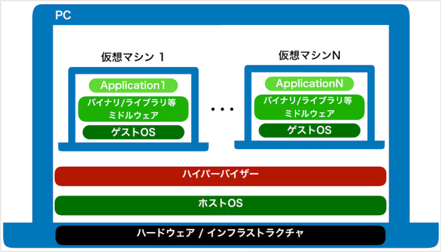
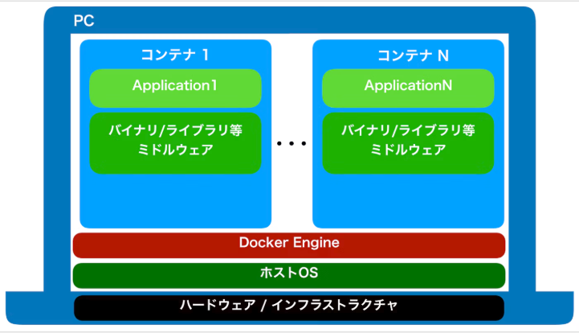

# Docker
## 従来の仮想化技術
従来、ホストOS上に仮想化ソフト/ハイパーバイザ(１台のコンピュータの上で複数の仮想的なコンピュータを同時に動かすためのソフトウェア)を使用して、仮想マシン/ゲストOSを立ち上げ、その仮想マシンの中でミドルウェアの環境構築をし、プログラムを実行してアプリケーションを動かすという構造になっていた。  



```  
メモ( ..)φメモメモ  
ホストOS;物理サーバー（建物）は１つだけ。  
その中に複数の部屋（仮想マシン）があり、それぞれ別の住人（OS）が住んでいる。  
管理人（ハイパーバイザ）が電気・水道（CPU, メモリ, ディスク, ネットワーク）を各部屋に割り振り、住人同士が干渉しないようにしている。  

ミドルウェア：OSとアプリケーションの間で多くのアプリが共通して必要とする機能を提供するソフトウェア。（DB, Webサーバー, APサーバーなど）
```  

## Docker：コンテナ型仮想化技術 とは  
Docekerとは、Docker社が提供する`コンテナ型仮想化技術`を実現するプロダクト。  

仮想化：  
PCやサーバーといったマシンにインストールされているOS(ホストOS)の上に、別のマシンを仮想的に立ち上げること。  
簡単に言うと、「パソコンの上に仮想パソコンを起動する」こと。  

従来とは異なり、ゲストOSを起動せずに、ホストOSの上に動作しているDocker Engineから`コンテナ`と呼ばれるミドルウェアの環境構築がされた実行環境を作成し、その中でアプリケーションを動作させる。  
  

これにより、圧倒的に軽量に動作することが出来る。  

### プロジェクトで大事なこと
① プログラムコードの共有  
重要なプログラムコードの共有には`Git`によるバージョン管理の仕組みが使用され、コードをチーム内で共有するためのサービスとして、GithubやBitBucket, Gitlabなどがある。  

② 実行環境の共有  
開発者間で利用しているOSは異なるため、プログラムの実行環境を共有しないとプログラムが正常に動作しないことは多々ある。  

そこで、仮想化によってフラットな仮想マシンを作成し、その仮想マシンを作成する設定などを共有することで、実行環境を共有することが出来る。  

`Docker`は、軽量な動作と環境ファイル共有を実現している。  
Dockerのメリットは一番のメリットは、`「ソフトウェアの実行環境を、複雑なアーキテクチャであっても、Dockerを使って管理することで、簡単にどんなマシンにでも共有できる」`という点である。  

## Dockerの要素  
A. Docker Engine  
B. イメージ(Image)  
C. コンテナ  

### A. Docker Engine
Dockerを利用するための常駐プログラム。  
Docker for macやDocker for Windows, Docker Toolboxなどのソフトをインストールすることで、利用可能になる。  

### B. イメージ(Image)
コンテナ（アプリケーションの実行環境）を起動するのに必要な設定ファイルをまとめたもの。  
`Imageはコンテナの元であり、Imageからコンテナを起動する`ものである。  
Docekrでは、このImageを共有することで、様々なマシンで同じコンテナ（実行環境）を動作させることが出来る。  

> Tag
Imageには`tag`という概念がある。tagとは、`imageのバージョン`のこと。  
tagには複数のimageのバージョンを保管でき、何も指定しなければ、自動的に最新のtagが使用されるようになっている。  

#### Imageの準備～  
ローカルマシンに取得しているImage一覧は以下で確認できる。  
```
docker images
```

imageの準備には、以下の2つの方法がある。  
1. 他人が作ったimageを(主に)Docekr Hubから取得  
2. 自分で作成(=既存のimageの改良)  
※2はゼロから作るという意味ではない。

1. Docker Hubからの取得  
Docker Hubには様々なミドルウェアが入ったImageが公開されているので、自分が使用したい環境に応じて以下のコマンドでImageを指定して取得する。  
```
docker pull イメージ名:タグ名
# タグ名を指定しなければ、最新のバージョンとなる  
```
```
docker image ls # pull済みのイメージを確認
```
2. Dockerfileからイメージ作成  
「Dockerfile」という名前のtextファイルを作り、その内にimage build(image作成)に関わる設定を記述して、そのDockerfileからイメージを作成する。  

設定時に用いる代表的なコマンドは以下です。  

| コマンド | 説明 | 使用例 |
| --- | --- | --- |
| `FROM` | ベースとなるイメージを指定します。最初に必ず記述します。 | `FROM ubuntu:20.04` |
| `RUN`           | コンテナ内でコマンドを実行します。主にパッケージのインストールや設定を行います。                  | `RUN apt-get update && apt-get install -y python3`                                          |
| `COPY`          | ホストマシンのファイルやディレクトリをコンテナ内にコピーします。                                  | `COPY ./app.py /app/`                                                                      |
| `ADD`           | `COPY` と似ていますが、アーカイブファイル（例：.tar）を展開したり、URL からファイルをコピーしたりします。(基本は COPY を使ったほうが better です) | `ADD myapp.tar /app/`                                                                      |
| `WORKDIR`       | 作業ディレクトリを設定します。以降のコマンドはこのディレクトリ内で実行されます。                     | `WORKDIR /app`                                                                              |
| `CMD`           | コンテナ起動時に実行されるコマンドを指定します。1つの `CMD` しか記述できません。                    | `CMD ["python3", "app.py"]`                                                                 |
| `VOLUME`        | コンテナとホスト間で共有するディレクトリを指定します。データの永続化に使います。                    | `VOLUME ["/data"]`                                                                           |
| `ENV`           | 環境変数を設定します。コンテナ内で使われる環境変数を指定できます。                               | `ENV APP_HOME /app`                                                                         |
| `ARG`           | ビルド時に渡される引数を定義します。`docker build` コマンドの `--build-arg` と合わせて使います。        | `ARG VERSION=1.0`                                                                           |
```
# 事例
FROM ubuntu:20.04

# 必要なパッケージをインストール（Python と pip）
RUN apt-get update && apt-get install -y vim python3 python3-pip

# 作業ディレクトリへ移動 (なければ作成)
WORKDIR /app

# アプリのファイルをコピー
COPY src/sample.py .
# コンテナ側の現在のディレクトリにコピーという意味で'.'を指定  

# コンテナ起動時に実行されるコマンド設定
CMD ["/bin/bash"]
```


Dockerfileがあるディレクトリ上で以下コマンドを実行すると、Dockerfileを基にimageが生成されます。  
```
dcoker build -t イメージ名 . 
# -tでイメージ名を指定  
# .(カレントディレクトリ)：ビルドコンテキスト。フォルダのこと。この中身を材料としてビルドに使います、という意味
```
```
docker image ls # イメージが作成されているか確認
```

### C. コンテナ
imageを用意したら、そのimageからコンテナ(=アプリケーションの実行環境)が起動できる。  
```
docker create --コンテナ名 # コンテナ作成  
```
```
docker start コンテナ名 # コンテナ起動

# imageをDockerHubから取得してコンテナを作成・起動するコマンド
docker run イメージ名
```

#### コンテナの操作コマンド
```
①イメージからコンテナを作成+起動+実行
docker container run -it イメージ:タグ /bin/bash
# この場合、コンテナ名はランダムに付けられる。  

docker container run -it --name コンテナ名 イメージ:タグ /bin/bash
#この場合、コンテナ名を指定できる。

②コンテナ停止
docker container stop コンテナ名
# コンテナ名：コンテナIDの頭5文字を指定しても同じ動き

③コンテナ削除 
docker container rm コンテナ名

# docker container run -it --name コンテナ --rm イメージ /bin/bash
# 起動時に--rmオプションを付けることで、コンテナから抜けると同時に削除されるようにも設定できる。
```

コンテナ内のファイルをホスト側に保存したり、ホスト側のファイルをコンテナ内で使用できるように、ホスト側のディレクトリやファイルをマウントすることができる。  
```
①マウントしたいディレクトリを用意
mkdir src # あくまで例
touch src/sample.py

②`-v`でホストとコンテナのマウント先を指定  
docker container run -it --name コンテナ -v ./src:/workspace イメージ /bin/bash
# コンテナ内にworkspaceフォルダを作成して、ホストのsrcと紐づけ
# こうすることで、ホスト側のsrcディレクトリ内のファイルがコンテナ側からも「見える」状態になる

※「見える」と表現したように、これはコピーされたわけではなく。見ている状態なため、どちらか一方を編集したら、両方ともに反映される。
```

 

## JupyterLab サーバー起動
Dockerのコンテナ上でJupyter Labを起動する方法。  
JupyterLab サーバーを作成するコンテナについては以下 Docker 公式 Docs を参考にコマンドを解説します。  

https://docs.docker.com/guides/jupyter/  

以下コマンドでJpyterLab サーバーを起動することができます。  

```sh
docker container run --rm -p 8888:8888 -v .:/home/jovyan/work quay.io/jupyter/base-notebook start-notebook.py
```

復習となりますが、まず`quay.io/jupyter/base-notebook`が使用するDockerイメージの名前です。  

これはJupyterのベースノートブックイメージで、Jupyterノートブックを動かすための基本的な設定が含まれています。  

`start-notebook.py`はコンテナ起動時に最初に実行するコマンドで、コンテナ内に既に用意されているJupyterLabを開始するための Pythonスクリプトがコンテナ内で実行されます。  

### -p オプションについて
`-p`オプションは、ポートの公開を設定するために使用します。具体的には、ホストマシン（あなたのコンピュータ）とコンテナ間でポート番号をバインドします。  

最初の8888は、ホストマシンのポート番号です。コンテナがこのポートを外部（ホスト側）に公開し、ホストマシン上でアクセスできるようにします。  

後ろの8888は、コンテナ内のポート番号です。コンテナがこのポートでリッスン（待機）して、外部からの接続を受け入れます。  

つまり、このコマンドでは ホストのポート8888をコンテナのポート 8888にマッピングしているという意味です。  

この設定によって、ホストマシンからコンテナ内のアプリケーションにアクセスできるようになります。  

JupyterLab は通常、デフォルトでポート8888を使用して、ブラウザでアクセスできるようにします。このコマンドでは、コンテナ内のJupyterサーバーがポート8888で動作し、ホストマシンの同じポート番号（8888）にアクセスできるように設定しています。  

コマンドを実行した後、ブラウザで http://localhost:8888 にアクセスすることで、JupyterLab が表示されるはずです。これは、ホストのポート8888がコンテナ内のポート8888にマッピングされているためです。  

`-v`が「フォルダをつなぐ」役割だったのに対して、`-p`は「通信の入り口をつなぐ」役割だと考えられる。

## docker compose
Docker Composeは複数のDockerコンテナを一括で定義・管理・実行できるツールとなっている。

Dockerは基本的に「1コンテナにつき、 1プログラムを動かすための箱」として働く。（実務(機械学習の提供)の例だと、推論API+MLflow+DB、のような感じ）1つのコンテナに全部入れると、1つ問題が起きたら図べ手が止まったりなど、問題が多数出てくる。そのため、複数作成して、一括で実行できるようにしておく必要がある。

まずあなたの環境で Docker Compose が使えるか確認してみましょう。

```sh
docker compose version
```

コマンドを実行してバージョンの確認ができたら使用可能です。

続いて Docker Compose を使うと便利なことの一部を紹介します。

### docker build/run 時のオプション等のコマンド入力を省略

JupyterLab サーバー起動の際に以下コマンドでコンテナ実行をしました。

```sh
docker container run -p 8888:8888 -v .:/home/jovyan/work quay.io/jupyter/base-notebook start-notebook.py
```

こちらを Docker Compose の設定ファイル `docker-compose.yml` に書き直すと

```
services:
  jupyter:  # 任意のサービス名
    image: quay.io/jupyter/base-notebook
    ports:
      - "8888:8888"
    volumes:
      - .:/home/jovyan/work
    command: start-notebook.py
```

となります。

設定ファイルに書き込んでおくことで、起動は以下コマンドだけで済みます。

```sh
docker compose up
```

### 複数コンテナの起動

参考に 「SQL100本ノック」のリポジトリを見てみましょう。

https://github.com/The-Japan-DataScientist-Society/100knocks-preprocess

こちらの `docker-compose.yml` を見てみましょう。

詳細は省きますが、この `docker-compose.yml` では

1. PostgreSQL
2. JupyterNotebook

の2つのコンテナを以下コマンドで同時に起動し、また連携もさせることができます。

```sh
docker compose up
```

